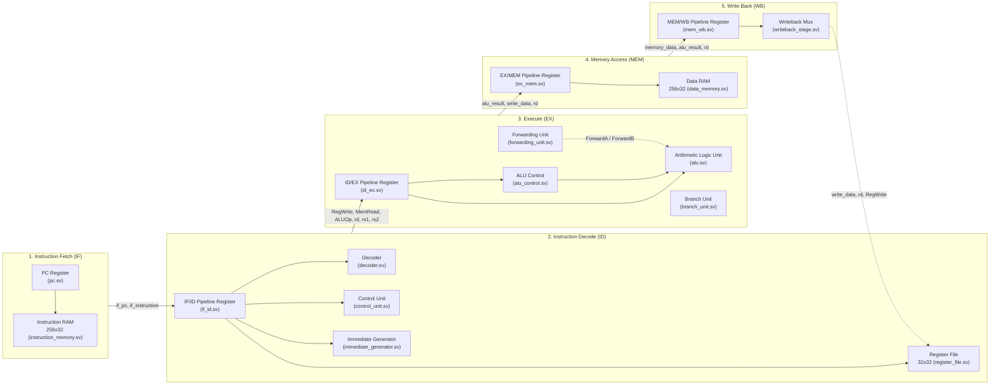
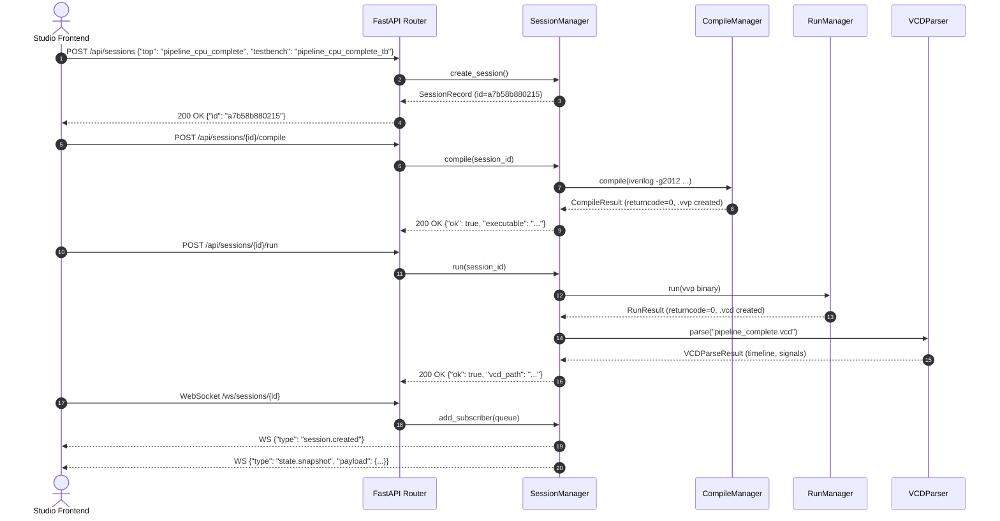
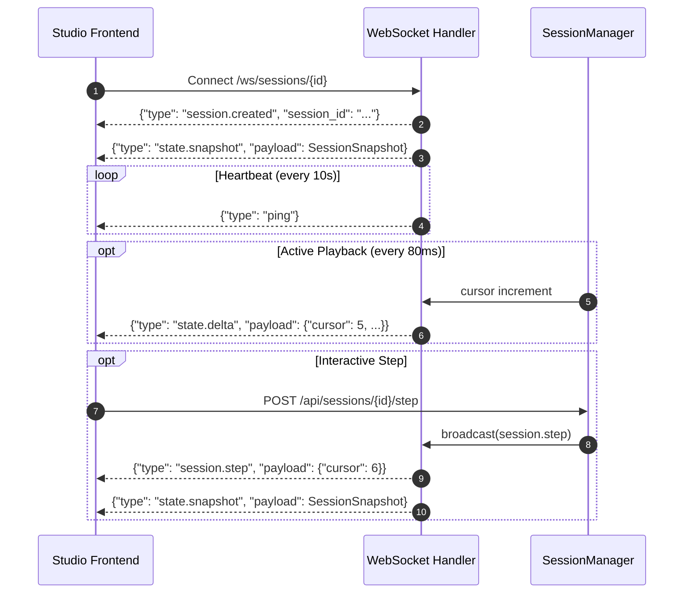

<div align="center">

# QuantumRISC

**Backend-Orchestrated RISC-V CPU Microarchitecture, RTL Simulation & Live Telemetry Platform**

`RV32I Subset` &middot; `SystemVerilog` &middot; `Icarus Verilog` &middot; `FastAPI` &middot; `WebSocket` &middot; `React 19 / TypeScript` &middot; `MIT License`

<p align="center">
  <a href="#at-a-glance">At a Glance</a> &middot;
  <a href="#engineering-highlights">Engineering Highlights</a> &middot;
  <a href="#architecture-overview">Architecture</a> &middot;
  <a href="#cpu-microarchitecture">Microarchitecture</a> &middot;
  <a href="#microarchitectural-design-trade-offs">Design Trade-offs</a> &middot;
  <a href="#claim-verification-table">Claim Verification</a> &middot;
  <a href="#simulation-orchestration-and-backend">Backend Engine</a> &middot;
  <a href="#end-to-end-api-workflow-curl">API Workflow (curl)</a> &middot;
  <a href="#vcd-parsing-and-state-reconstruction">VCD Reconstruction</a> &middot;
  <a href="#websocket-telemetry-protocol">WebSocket Protocol</a> &middot;
  <a href="#quantumrisc-studio">Studio UI</a> &middot;
  <a href="#verification-and-validation-evidence">Verification</a> &middot;
  <a href="#quickstart-and-reproducibility">Quickstart</a> &middot;
  <a href="#capability-matrix">Capability Matrix</a> &middot;
  <a href="#limitations-and-known-issues">Limitations</a>
</p>

</div>

---

## At a Glance

| Aspect | Implementation in Repository | Evidence Source |
| :--- | :--- | :--- |
| **Target ISA** | RV32I integer subset (R-type, I-type ALU, LW, SW, BEQ, JAL) | [`rtl/cpu/decoder.sv`](rtl/cpu/decoder.sv), [`rtl/cpu/control_unit.sv`](rtl/cpu/control_unit.sv) |
| **HDL & Standard** | SystemVerilog (IEEE 1800-2012) | [`rtl/`](rtl/), compiled with `iverilog -g2012` |
| **Pipeline Cores** | Modular 5-stage core (`pipeline_cpu_complete.sv`) and single-cycle baseline (`cpu_top.sv`) | [`rtl/cpu/pipeline_cpu_complete.sv`](rtl/cpu/pipeline_cpu_complete.sv), [`rtl/cpu/cpu_top.sv`](rtl/cpu/cpu_top.sv) |
| **Hazard Handling** | Load-use hazard detection unit (stall insertion) and EX/MEM, MEM/WB data forwarding unit | [`rtl/pipeline/hazard_detection_unit.sv`](rtl/pipeline/hazard_detection_unit.sv), [`rtl/pipeline/forwarding_unit.sv`](rtl/pipeline/forwarding_unit.sv) |
| **Simulation Toolchain** | Icarus Verilog (`iverilog`) compiler + `vvp` runtime generating standard IEEE 1364 VCD traces | [`backend/app/sim/compile_manager.py`](backend/app/sim/compile_manager.py), [`backend/app/sim/run_manager.py`](backend/app/sim/run_manager.py) |
| **Backend Orchestration**| FastAPI (Python 3.10+) managing process execution, SQLite session persistence, and WebSocket broadcasting | [`backend/app/main.py`](backend/app/main.py), [`backend/app/sessions/manager.py`](backend/app/sessions/manager.py) |
| **Telemetry & Parsing** | Custom VCD parser extracting cycle timestamps, signal transitions, and register/pipeline frames | [`backend/app/sim/vcd_parser.py`](backend/app/sim/vcd_parser.py), [`backend/app/trackers/`](backend/app/trackers/) |
| **Engineering Studio** | React 19, TypeScript, Vite, Tailwind CSS v4, Radix UI; interactive pipeline, register table, schematics, and timeline scrubbing | [`frontend/studio/`](frontend/studio/) |
| **Automated Testing** | 8 backend integration/unit tests (`pytest`) + 22 SystemVerilog testbenches | [`backend/tests/`](backend/tests/), [`verification/tb/`](verification/tb/) |

> [!NOTE]
> **Scope and Honesty Statement**
> Every capability, schema, signal name, and command in this document is derived directly from committed source code, configuration files, and executed tests. Unsupported features (such as CSRs, privilege rings, dynamic branch prediction, hardware caches, and physical FPGA synthesis) are explicitly documented as absent rather than simulated or mocked.

---

## Engineering Highlights

1. **Hardware-to-Software State Mapping**: Employs non-intrusive VCD waveform signal extraction to reconstruct microarchitectural register, memory, hazard, and pipeline state frames directly from open-source Icarus Verilog runs.
2. **Dual Core Architecture Support**: Supports both a single-cycle educational baseline ([`cpu_top.sv`](rtl/cpu/cpu_top.sv)) and a modular 5-stage pipelined design ([`pipeline_cpu_complete.sv`](rtl/cpu/pipeline_cpu_complete.sv)) selectable via discovery and session configuration.
3. **Hazard & Forwarding Telemetry**: Analyzes sequential instruction streams to identify Read-After-Write (RAW) data dependencies and verify active `EX/MEM -> EX` and `MEM/WB -> EX` forwarding paths.
4. **Reactive WebSocket Broadcasting**: Manages simulation playback with pause, resume, reset, and single-cycle stepping over WebSocket connections backed by asynchronous Python queues.
5. **Decoupled Verification Architecture**: Isolates compilation and simulation tasks into ephemeral session workspaces under `runs/{session_id}/`, persisting session metadata in SQLite.

---

## Architecture Overview

```mermaid
flowchart LR
    A["RTL Source & Testbenches<br/>(rtl/, verification/)"] --> B["Icarus Verilog Compiler<br/>(iverilog -g2012 -Wall)"]
    B --> C["Simulation Binary<br/>(.vvp executable)"]
    C --> D["VVP Runtime Execution<br/>(runs/{session_id}/)"]
    D --> E["Raw VCD Waveform<br/>(pipeline_complete.vcd)"]
    E --> F["VCD Parser & Analyzers<br/>(backend/app/sim/vcd_parser.py)"]
    F --> G["FastAPI Session Manager<br/>(SQLite + State Trackers)"]
    G -->|WebSocket Telemetry| H["QuantumRISC Studio<br/>(frontend/studio/)"]
    G -->|REST APIs| H
```



### Data Contracts Between Layers

1. **RTL to Simulation Boundary**: [`CompileManager`](backend/app/sim/compile_manager.py) aggregates all `.sv` sources in [`rtl/`](rtl/) and the selected testbench in [`verification/tb/`](verification/tb/), compiling via `iverilog -g2012 -Wall -s <top> -o <build_path>.vvp`.
2. **Simulation to Trace Boundary**: [`RunManager`](backend/app/sim/run_manager.py) spawns `vvp` in an isolated session folder (`runs/<session_id>/`). Testbenches execute `$dumpfile("pipeline_complete.vcd")` and `$dumpvars(0, <tb>)` to emit IEEE 1364 Value Change Dump (VCD) traces.
3. **Trace to State Boundary**: [`VCDParser`](backend/app/sim/vcd_parser.py) reads signal headers and value deltas across timestamp boundaries, reconstructing discrete architectural execution frames without requiring proprietary commercial licenses.
4. **Backend to Studio Boundary**: Session snapshots conforming to Pydantic [`SessionSnapshot`](backend/app/models/schemas.py) stream across persistent WebSockets (`/ws/sessions/{id}`) to drive the React frontend cycle by cycle.

---

## CPU Microarchitecture



### Supported Instructions

Instruction decoding and control flow are implemented across [`rtl/cpu/decoder.sv`](rtl/cpu/decoder.sv), [`rtl/cpu/control_unit.sv`](rtl/cpu/control_unit.sv), [`rtl/cpu/alu_control.sv`](rtl/cpu/alu_control.sv), and [`rtl/cpu/alu.sv`](rtl/cpu/alu.sv):

| Format | Instruction | Opcode (`[6:0]`) | `funct3` | `funct7` | Operation / Semantics |
| :--- | :--- | :--- | :--- | :--- | :--- |
| **R-Type** | `ADD` | `7'b0110011` (`0x33`) | `3'b000` | `7'b0000000` | `R[rd] = R[rs1] + R[rs2]` |
| | `SUB` | `7'b0110011` (`0x33`) | `3'b000` | `7'b0100000` | `R[rd] = R[rs1] - R[rs2]` |
| | `AND` | `7'b0110011` (`0x33`) | `3'b111` | Any | `R[rd] = R[rs1] & R[rs2]` |
| | `OR` | `7'b0110011` (`0x33`) | `3'b110` | Any | `R[rd] = R[rs1] | R[rs2]` |
| | `XOR` | `7'b0110011` (`0x33`) | `3'b100` | Any | `R[rd] = R[rs1] ^ R[rs2]` |
| | `SLL` | `7'b0110011` (`0x33`) | `3'b001` | Any | `R[rd] = R[rs1] << R[rs2][4:0]` |
| | `SRL` | `7'b0110011` (`0x33`) | `3'b101` | Any | `R[rd] = R[rs1] >> R[rs2][4:0]` (logical) |
| | `SLT` | `7'b0110011` (`0x33`) | `3'b010` | Any | `R[rd] = ($signed(R[rs1]) < $signed(R[rs2])) ? 1 : 0` |
| **I-Type** | `ADDI` | `7'b0010011` (`0x13`) | `3'b000` | &mdash; | `R[rd] = R[rs1] + imm` |
| | `ANDI` | `7'b0010011` (`0x13`) | `3'b111` | &mdash; | `R[rd] = R[rs1] & imm` |
| | `ORI` | `7'b0010011` (`0x13`) | `3'b110` | &mdash; | `R[rd] = R[rs1] | imm` |
| | `XORI` | `7'b0010011` (`0x13`) | `3'b100` | &mdash; | `R[rd] = R[rs1] ^ imm` |
| | `SLLI` | `7'b0010011` (`0x13`) | `3'b001` | &mdash; | `R[rd] = R[rs1] << imm[4:0]` |
| | `SRLI` | `7'b0010011` (`0x13`) | `3'b101` | &mdash; | `R[rd] = R[rs1] >> imm[4:0]` (logical) |
| | `SLTI` | `7'b0010011` (`0x13`) | `3'b010` | &mdash; | `R[rd] = ($signed(R[rs1]) < $signed(imm)) ? 1 : 0` |
| | `LW` | `7'b0000011` (`0x03`) | `3'b010` | &mdash; | `R[rd] = Mem32[R[rs1] + imm]` (word aligned) |
| **S-Type** | `SW` | `7'b0100011` (`0x23`) | `3'b010` | &mdash; | `Mem32[R[rs1] + imm] = R[rs2]` (word aligned) |
| **B-Type** | `BEQ` | `7'b1100011` (`0x63`) | `3'b000` | &mdash; | `if (R[rs1] == R[rs2]) PC = PC + imm` |
| **J-Type** | `JAL` | `7'b1101111` (`0x6F`) | &mdash; | &mdash; | `PC = PC + imm; R[rd] = PC + 4` |

### Explicitly Unsupported / Absent Instructions

* **Unimplemented Base Instructions**: `LUI` (`0x37`), `AUIPC` (`0x17`), `JALR` (`0x67`), `BNE`, `BLT`, `BGE`, `BLTU`, `BGEU`, `LB`, `LH`, `LBU`, `LHU`, `SB`, `SH`, `SRA`, `SRAI`, `SLTU`, `SLTIU`, `FENCE`, `ECALL`, `EBREAK`.
* **Privilege & Traps**: No CSR registers, no M/S/U privilege rings, no exception/interrupt handlers.
* **Extensions**: Standard extensions M (Hardware Multiply/Divide), A (Atomics), F/D (Floating Point), and C (Compressed) are absent.

### Microarchitectural Details

* **Hazard Detection**: [`hazard_detection_unit.sv`](rtl/pipeline/hazard_detection_unit.sv) evaluates load-use hazards during Decode. If `MemRead_EX` is asserted and `rd_EX != 0` matches `rs1_ID` or `rs2_ID`, it asserts `stall = 1'b1`.
* **Data Forwarding**: [`forwarding_unit.sv`](rtl/pipeline/forwarding_unit.sv) compares `rs1_EX` and `rs2_EX` against destination registers in `MEM` (`rd_MEM`) and `WB` (`rd_WB`). If matching and write-enabled, it sets `ForwardA`/`ForwardB` to `2'b10` (EX hazard forwarding from MEM) or `2'b01` (MEM hazard forwarding from WB).
* **Branch Resolution & Pipeline Flush**: [`branch_unit.sv`](rtl/pipeline/branch_unit.sv) calculates branch targets combinationally. In `pipeline_cpu_complete.sv`, the `flush` port of `if_id.sv` is tied to `1'b0`; full speculative branch flushing is not integrated in the top-level wire loop.
* **Register Zero (x0)**: Enforced in [`register_file.sv`](rtl/cpu/register_file.sv) via synchronous write filtering (`if (we && rd != 0) registers[rd] <= write_data; registers[0] <= 32'b0;`). No internal write-through bypass exists; simultaneous read/write to the same register in the same cycle requires external forwarding.
* **Memory Model**: Harvard architecture. Both [`instruction_memory.sv`](rtl/cpu/instruction_memory.sv) and [`data_memory.sv`](rtl/memory/data_memory.sv) contain 256 words (1,024 bytes), indexed using word-aligned bits `address[9:2]`. Sub-word writes and unaligned access are not implemented.
* **Program Loading**: Programs are loaded via Verilog `initial` blocks in `instruction_memory.sv` (defaulting to 4 sample instructions) or `$readmemh` memory initialization templates. Dynamic runtime firmware uploading via backend API is not implemented.

---

## Microarchitectural Design Trade-offs

| Design Area | Chosen Implementation | Trade-off / Rationale |
| :--- | :--- | :--- |
| **Pipeline Registers** | Explicit modular register modules (`if_id.sv`, `id_ex.sv`, etc.) | Increases file count and port wiring complexity, but enables isolated per-stage testbench verification. |
| **Hazard Strategy** | Combinational forwarding + load-use stall unit | Avoids pipeline flushes on standard ALU data dependencies; stall is required only on 1-cycle load-use latency. |
| **Branch Handling** | Combinational target adder in branch unit | Eliminates complex branch history tables and predictor state machines; branches resolve with static target computation. |
| **Register File Read** | Asynchronous combinational read ports | Simplifies Decode stage timing; requires external forwarding unit since write-through bypass is omitted from the register macro. |
| **Memory Bus** | Word-aligned 32-bit width (`address[9:2]`) | Avoids byte-enable lane multiplexers and sign-extension hardware, restricting software to full-word memory operations. |

---

## Claim Verification Table

| Claim | Verified in Code | Primary Source File | Notes |
| :--- | :---: | :--- | :--- |
| **5-Stage Pipeline** | Yes | [`rtl/pipeline/`](rtl/pipeline/) | Modular stage registers and top-level implementation. |
| **RAW Hazard Detection** | Yes | [`rtl/pipeline/hazard_detection_unit.sv`](rtl/pipeline/hazard_detection_unit.sv) | Detects load-use hazard condition. |
| **ALU Operations** | Yes | [`rtl/cpu/alu.sv`](rtl/cpu/alu.sv) | ADD, SUB, AND, OR, XOR, SLL, SRL, SLT. SRA and SLTU are absent. |
| **Dynamic Branch Predictor** | No | [`rtl/pipeline/branch_unit.sv`](rtl/pipeline/branch_unit.sv) | Static target adder only. |
| **Hardware L1 Cache** | No | [`rtl/cache/`](rtl/cache/) | Directory exists but contains no RTL modules. |
| **FPGA Synthesis Metrics** | No | [`backend/app/sessions/manager.py`](backend/app/sessions/manager.py) | Backend reports synthesis telemetry unavailable. |
| **Automated Backend Tests** | Yes | [`backend/tests/`](backend/tests/) | 8 pytest tests pass locally in 15.35s. |

---

## Simulation Orchestration and Backend



### REST API Endpoints

| Method | Endpoint | Request Body | Response Model | Description |
| :--- | :--- | :--- | :--- | :--- |
| `GET` | `/api/health` | None | `HealthCheck` | Verifies repository paths, SQLite access, and `iverilog`/`vvp` availability. |
| `GET` | `/api/discovery` | None | [`DiscoveryResponse`](backend/app/models/schemas.py) | Discovers all top modules, testbenches, and `.sv` files in workspace. |
| `POST` | `/api/sessions` | [`SessionCreateRequest`](backend/app/models/schemas.py) | [`SessionCreateResponse`](backend/app/models/schemas.py) | Initializes workspace directory in `runs/{id}` and registers session in SQLite. |
| `GET` | `/api/sessions/{id}` | None | [`SessionSnapshot`](backend/app/models/schemas.py) | Fetches full architectural snapshot at current simulation cursor. |
| `POST` | `/api/sessions/{id}/compile` | None | [`CompileResponse`](backend/app/models/schemas.py) | Executes Icarus Verilog compiler with 60s timeout lock. |
| `POST` | `/api/sessions/{id}/run` | None | [`RunResponse`](backend/app/models/schemas.py) | Executes `vvp` simulation, emits VCD, and populates parsed timeline. |
| `POST` | `/api/sessions/{id}/pause` | None | [`SessionSnapshot`](backend/app/models/schemas.py) | Pauses background playback task. |
| `POST` | `/api/sessions/{id}/resume` | None | [`SessionSnapshot`](backend/app/models/schemas.py) | Starts asynchronous playback loop broadcasting state deltas every 80ms. |
| `POST` | `/api/sessions/{id}/reset` | None | [`SessionSnapshot`](backend/app/models/schemas.py) | Rewinds cursor to cycle 0 and broadcasts reset event. |
| `POST` | `/api/sessions/{id}/step` | None | [`SessionSnapshot`](backend/app/models/schemas.py) | Advances simulation cursor by 1 cycle step. |
| `GET` | `/api/sessions/{id}/snapshot`| None | [`SessionSnapshot`](backend/app/models/schemas.py) | Explicit snapshot endpoint matching `/api/sessions/{id}`. |
| `GET` | `/api/sessions/{id}/vcd` | None | `{"path": str, "name": str}` | Returns host path to generated VCD artifact. |
| `GET` | `/studio` | None | HTML | Statically serves pre-built Studio frontend. |

> [!WARNING]
> **Subprocess Execution and Security Posture**
> The backend executes `iverilog` and `vvp` directly on the host using `asyncio.subprocess` without container isolation, seccomp sandboxing, or user authentication. QuantumRISC is designed for local workstations and private lab environments. It must not be exposed directly to untrusted public networks.

---

## End-to-End API Workflow (curl)

The complete lifecycle can be executed from a shell against a running backend:

```bash
# 1. Check backend toolchain and database health
curl -s http://127.0.0.1:8000/api/health

# 2. Discover available RTL modules and testbenches
curl -s http://127.0.0.1:8000/api/discovery

# 3. Create a new simulation session
curl -s -X POST http://127.0.0.1:8000/api/sessions \
  -H "Content-Type: application/json" \
  -d '{"top": "pipeline_cpu_complete", "testbench": "pipeline_cpu_complete_tb"}'
# Response returns session ID: e.g. "a7b58b880215"

# 4. Trigger Icarus Verilog compilation
curl -s -X POST http://127.0.0.1:8000/api/sessions/a7b58b880215/compile

# 5. Run simulation to produce VCD and timeline
curl -s -X POST http://127.0.0.1:8000/api/sessions/a7b58b880215/run

# 6. Step simulation forward by one cycle
curl -s -X POST http://127.0.0.1:8000/api/sessions/a7b58b880215/step

# 7. Retrieve full architectural state snapshot
curl -s http://127.0.0.1:8000/api/sessions/a7b58b880215/snapshot
```

---

## VCD Parsing and State Reconstruction

Waveform traces are parsed from standard VCD format into structured microarchitectural state by [`VCDParser`](backend/app/sim/vcd_parser.py):

1. **Hierarchy & Symbol Resolution**: Scans `$scope` and `$upscope` tokens to build hierarchical dot-delimited signal identifiers. Maps 1-to-many compressed VCD character codes via regex (`^\$var\s+\w+\s+(\d+)\s+(\S+)\s+(.+?)\s+\$end$`).
2. **Transition Parsing**: Scans timestamp tokens (`#<timestamp>`), tracking scalar (`0`, `1`, `x`, `z`) and vector (`b<bits> <code>`) value assignments.
3. **State Replay**:
   * [`PipelineTracker`](backend/app/trackers/pipeline_tracker.py): Inspects signal candidates (`pc_current`, `instruction`, `if_pc`, `if_instruction`, `alu_result`) to construct per-stage execution dictionaries (`IF`, `ID`, `EX`, `MEM`, `WB`).
   * [`RegisterTracker`](backend/app/trackers/register_tracker.py): Replays register write events across the timeline where `RegWrite == 1` and `rd != 0`, tracking the full 32-register architectural state table with ABI naming.
   * [`HazardAnalyzer`](backend/app/analyzers/hazard_analyzer.py): Detects sequential Read-After-Write (RAW) data dependencies between producer `rd` and consumer `rs1`/`rs2`.
   * [`MetricsEngine`](backend/app/analyzers/metrics_engine.py): Samples clock transitions (`clk == 1`), counting elapsed cycles, instructions retired, stall cycles, flushes, CPI, and IPC.

### Real Captured Session Snapshot (API Response)

The following JSON represents actual data emitted by `manager.snapshot()` during execution:

```json
{
  "session_id": "a7b58b880215",
  "status": "running",
  "top": "pipeline_cpu_complete",
  "testbench": "pipeline_cpu_complete_tb",
  "playback": {
    "cursor": 1,
    "total": 45,
    "paused": false,
    "mode": "playing"
  },
  "pipeline": {
    "IF": {
      "pc": "0x0",
      "instruction": "0x13"
    },
    "ID": {
      "pc": "0x0",
      "instruction": "0x13"
    }
  },
  "registers": [
    { "index": 0, "name": "x0", "abi": "zero", "value": "0x00000000" },
    { "index": 1, "name": "x1", "abi": "ra", "value": "0x00000000" },
    { "index": 2, "name": "x2", "abi": "sp", "value": "0x00000000" },
    { "index": 3, "name": "x3", "abi": "gp", "value": "0x00000000" }
  ],
  "hazards": [
    {
      "kind": "RAW",
      "resolved": "forwarded",
      "producer_pc": "0x00000008",
      "consumer_pc": "0x0000000C",
      "producer_rd": 2
    },
    {
      "kind": "RAW",
      "resolved": "forwarded",
      "producer_pc": "0x0000000C",
      "consumer_pc": "0x00000010",
      "producer_rd": 3
    }
  ],
  "forwarding": [
    {
      "path": "EX/MEM -> EX",
      "reason": "RAW",
      "consumer_pc": "0x0000000C",
      "producer_pc": "0x00000008"
    },
    {
      "path": "EX/MEM -> EX",
      "reason": "RAW",
      "consumer_pc": "0x00000010",
      "producer_pc": "0x0000000C"
    }
  ],
  "metrics": {
    "cycles": 20,
    "retired": 20,
    "stalls": 0,
    "hazards": 2,
    "forwards": 2,
    "flushes": 0,
    "ipc": 1.0,
    "cpi": 1.0
  }
}
```

---

## WebSocket Telemetry Protocol

Real-time telemetry connects to `ws://127.0.0.1:8000/ws/sessions/{session_id}`:



| Message Type | Direction | Payload Structure | Semantics |
| :--- | :--- | :--- | :--- |
| `session.created` | Server &rarr; Client | `{"type": "session.created", "session_id": str}` | Confirms WebSocket subscription registration. |
| `state.snapshot` | Server &rarr; Client | `{"type": "state.snapshot", "payload": SessionSnapshot}` | Emits complete architectural state at current cycle. |
| `state.delta` | Server &rarr; Client | `{"type": "state.delta", "payload": {"cursor": int, ...}}` | Emitted every 80ms during active unpaused playback. |
| `session.paused` | Server &rarr; Client | `{"type": "session.paused", "payload": {"cursor": int}}` | Notifies that playback has paused. |
| `session.resumed` | Server &rarr; Client | `{"type": "session.resumed", "payload": {"cursor": int}}` | Notifies that playback has resumed. |
| `session.reset` | Server &rarr; Client | `{"type": "session.reset", "payload": {"cursor": 0}}` | Notifies that the timeline cursor has rewound to 0. |
| `session.step` | Server &rarr; Client | `{"type": "session.step", "payload": {"cursor": int}}` | Notifies that execution advanced by 1 cycle step. |
| `ping` | Server &rarr; Client | `{"type": "ping"}` | Periodic keepalive frame emitted every 10 seconds. |

---

## QuantumRISC Studio

The frontend is an engineering workbench built with React 19, TypeScript, Vite, Tailwind CSS v4, Lucide icons, and Radix UI primitives located in [`frontend/studio/`](frontend/studio/):

| Panel / Component | Source Implementation | Status | Description |
| :--- | :--- | :---: | :--- |
| **Pipeline Workbench** | [`QuantumRiscStudio.tsx`](frontend/studio/src/components/quantumrisc/QuantumRiscStudio.tsx) | ✅ Implemented | Live 5-stage pipeline view (IF, ID, EX, MEM, WB) showing active PC, opcode, and decoded instruction. |
| **Register Inspector** | [`QuantumRiscStudio.tsx`](frontend/studio/src/components/quantumrisc/QuantumRiscStudio.tsx) | ✅ Implemented | Complete 32-register table with ABI names, hex formatting, and writeback diff highlighting. |
| **Execution Toolbar** | [`QuantumRiscStudio.tsx`](frontend/studio/src/components/quantumrisc/QuantumRiscStudio.tsx) | ✅ Implemented | Interactive controls: Compile, Run, Pause, Resume, Step, and Reset. |
| **Waveform Scrubber** | [`QuantumRiscStudio.tsx`](frontend/studio/src/components/quantumrisc/QuantumRiscStudio.tsx) | ✅ Implemented | Cycle scrubber allowing instant random-access seeking across VCD transition history. |
| **Hardware Schematic** | [`Schematics.tsx`](frontend/studio/src/components/quantumrisc/Schematics.tsx) | ✅ Implemented | Visual datapath diagram displaying interconnected ALU, Register File, and control multiplexers. |
| **Hazard & Forwarding** | [`QuantumRiscStudio.tsx`](frontend/studio/src/components/quantumrisc/QuantumRiscStudio.tsx) | ✅ Implemented | Displays detected RAW dependencies and active EX/MEM forwarding paths. |
| **Cache Analysis** | [`QuantumRiscStudio.tsx`](frontend/studio/src/components/quantumrisc/QuantumRiscStudio.tsx) | ⛔ Unavailable | Explicitly reports unavailable: *"No cache implementation exists in current RTL"*. |
| **Branch Predictor** | [`QuantumRiscStudio.tsx`](frontend/studio/src/components/quantumrisc/QuantumRiscStudio.tsx) | 🟡 Partial | Shows static branch unit signals; reports that dynamic predictor tables (BTB/BHT) are absent. |
| **FPGA Synthesis** | [`QuantumRiscStudio.tsx`](frontend/studio/src/components/quantumrisc/QuantumRiscStudio.tsx) | ⛔ Unavailable | Explicitly reports unavailable: *"The current backend flow does not emit synthesis reports"*. |

---

## Verification and Validation Evidence

### Backend Pytest Suite

The backend test suite verifies discovery, compilation, simulation execution, VCD parsing, and tracker state reconstruction:

```bash
# Executed in backend/ with Python virtual environment active
pytest tests/ -v
```

```text
============================= test session starts =============================
platform win32 -- Python 3.13.14, pytest-9.1.1, pluggy-1.7.0
rootdir: C:\Users\Chand\OneDrive\Desktop\QuantumRISC\backend
collected 8 items

tests/test_api_real_simulation_smoke.py::test_api_real_simulation_smoke PASSED [ 12%]
tests/test_discovery.py::test_discovery_finds_tb PASSED                  [ 25%]
tests/test_engine_pipeline.py::test_vcd_parser_scope_and_timestamps PASSED [ 37%]
tests/test_engine_pipeline.py::test_metrics_engine_cycle_and_retired PASSED [ 50%]
tests/test_engine_pipeline.py::test_register_tracker_multiple_writes PASSED [ 62%]
tests/test_engine_pipeline.py::test_session_manager_end_to_end PASSED    [ 75%]
tests/test_engine_pipeline.py::test_run_response_on_invalid_build_path PASSED [ 87%]
tests/test_vcd_parser.py::test_parser_handles_missing_file PASSED        [100%]

============================== 8 passed in 15.35s ==============================
```

### RTL Verification Testbenches

The repository contains 22 SystemVerilog testbenches in [`verification/tb/`](verification/tb/):

* **Top-Level Integration**: [`pipeline_cpu_complete_tb.sv`](verification/tb/pipeline_cpu_complete_tb.sv) exercises instruction fetch, execution, and register writeback over 200ns, dumping `pipeline_complete.vcd`.
* **Single-Cycle Smoke Test**: [`cpu_top_tb.sv`](verification/tb/cpu_top_tb.sv) exercises basic instruction flow and dumps `cpu_dump.vcd`.
* **Unit Testbenches**: 20 modular testbenches verifying individual blocks:
  `alu_tb.sv`, `alu_control_tb.sv`, `branch_unit_tb.sv`, `control_unit_tb.sv`, `data_memory_tb.sv`, `decoder_tb.sv`, `execute_stage_tb.sv`, `ex_mem_tb.sv`, `forwarding_unit_tb.sv`, `hazard_detection_tb.sv`, `id_ex_tb.sv`, `if_id_tb.sv`, `immediate_generator_tb.sv`, `instruction_memory_tb.sv`, `memory_stage_tb.sv`, `mem_wb_tb.sv`, `pc_tb.sv`, `pipeline_cpu_tb.sv`, `register_file_tb.sv`, `writeback_stage_tb.sv`.

### Verification Status & Limitations

* **Functional Coverage**: Not measured. [`verification/coverage.sv`](verification/coverage.sv) is an empty stub (0 bytes).
* **Formal Verification**: Not available. [`verification/assertions.sv`](verification/assertions.sv) is an empty stub (0 bytes).
* **Compliance Suites**: RISC-V architectural compliance test suites (`riscv-arch-test` or `riscv-tests`) are not integrated.

---

## Quickstart and Reproducibility

### Prerequisites

* **Python**: 3.10 or higher
* **Node.js**: 20 or higher (with `npm`)
* **Hardware Simulator**: Icarus Verilog (`iverilog`) and `vvp` runtime in system `PATH`
  * *Ubuntu/Debian*: `sudo apt-get install -y iverilog`
  * *macOS*: `brew install icarus-verilog`
  * *Windows*: Download from Icarus Verilog for Windows or install via Chocolatey (`choco install icarus-verilog`)

### 1. Backend Setup & Test Execution

```bash
# Navigate to backend directory
cd backend

# Create virtual environment
python -m venv .venv

# Activate virtual environment
# On Windows (PowerShell):
.\.venv\Scripts\Activate.ps1
# On Linux / macOS:
# source .venv/bin/activate

# Install dependencies
pip install -r requirements.txt
pip install pytest

# Run backend verification suite
pytest tests/ -v
```

### 2. Standalone RTL Simulation via CLI

```bash
# From workspace root, compile pipeline CPU and testbench
iverilog -g2012 -Wall \
  -I rtl -I rtl/common -I rtl/cpu -I rtl/memory -I rtl/pipeline -I verification \
  -s pipeline_cpu_complete_tb \
  -o pipeline_sim.vvp \
  rtl/cpu/*.sv rtl/memory/*.sv rtl/pipeline/*.sv verification/tb/pipeline_cpu_complete_tb.sv

# Execute simulation to generate VCD
vvp pipeline_sim.vvp
```

### 3. Launching Backend Server

```bash
# From backend directory with venv active
uvicorn app.main:app --host 127.0.0.1 --port 8000 --reload
```

The API health check will be accessible at: `http://127.0.0.1:8000/api/health`.

### 4. Launching Studio Frontend

```bash
# In a separate terminal, navigate to frontend/studio
cd frontend/studio

# Install dependencies
npm install

# Build production bundle
npm run build

# Start local development server
npm run dev
```

Studio workbench will be accessible at: `http://127.0.0.1:5173/studio/`.

---

**Live Demo:** Open the [QuantumRISC Studio](https://quantum-risc-fzm5.vercel.app/) and set the Backend Address to `https://quantumrisc-backend.onrender.com` to connect to the hosted backend. Note: backend health confirms service reachability; initialize a CPU session to access simulation state.

---

## Repository Structure

```
QuantumRISC/
├── .github/
│   └── workflows/
│       └── ci.yml               # GitHub Actions CI (backend tests, website build, studio build)
├── backend/
│   ├── app/
│   │   ├── analyzers/           # RAW hazard, forwarding, and microarchitecture metrics engines
│   │   ├── api/                 # FastAPI REST routes and WebSocket session endpoints
│   │   ├── config/              # Runtime settings, simulator path resolution, and CORS
│   │   ├── models/              # Pydantic schemas for requests, responses, and state snapshots
│   │   ├── sessions/            # SQLite persistence and subscription broadcast manager
│   │   ├── sim/                 # Subprocess compilers, VVP runners, and VCD trace parser
│   │   └── trackers/            # Cycle-accurate pipeline, register, and memory reconstructors
│   ├── tests/                   # Pytest suite validating API, compilation, and VCD parsing
│   └── requirements.txt         # FastAPI, Uvicorn, Pydantic, and HTTPX dependencies
├── frontend/
│   ├── docs/                    # Technical documentation portal (React / Vite)
│   ├── studio/                  # QuantumRISC Studio microarchitecture workbench (React 19 / Vite)
│   └── website/                 # Public presentation website (React / Vite)
├── rtl/
│   ├── cpu/                     # ALU, control unit, decoder, immediate generator, register file
│   ├── memory/                  # 256x32-bit synchronous data memory
│   └── pipeline/                # Stage registers (IF/ID, ID/EX, EX/MEM, MEM/WB), hazard & forwarding
├── verification/
│   ├── tb/                      # 22 SystemVerilog unit and integration testbenches
│   ├── assertions.sv            # SVA assertions stub (0 bytes)
│   └── coverage.sv              # Functional coverage stub (0 bytes)
├── LICENSE                      # MIT License
└── README.md                    # Root architectural documentation
```

---

## Capability Matrix

| Microarchitecture / Platform Feature | Status | Evidence Source | Technical Notes |
| :--- | :---: | :--- | :--- |
| **RV32I Base Integer Instructions** | 🟡 Partial | [`rtl/cpu/control_unit.sv`](rtl/cpu/control_unit.sv) | Implements ADD, SUB, AND, OR, XOR, SLL, SRL, SLT, ADDI, ANDI, ORI, XORI, SLLI, SRLI, SLTI, LW, SW, BEQ, JAL. LUI, AUIPC, JALR, other branch conditions, and sub-word loads/stores are absent. |
| **5-Stage Pipeline Partitioning** | ✅ Implemented | [`rtl/pipeline/`](rtl/pipeline/) | Modular pipeline registers (`if_id.sv`, `id_ex.sv`, `ex_mem.sv`, `mem_wb.sv`) implemented and unit tested. |
| **Load-Use Hazard Detection** | ✅ Implemented | [`rtl/pipeline/hazard_detection_unit.sv`](rtl/pipeline/hazard_detection_unit.sv) | Detects load-to-use dependency and asserts stall signal. |
| **Data Forwarding Paths** | ✅ Implemented | [`rtl/pipeline/forwarding_unit.sv`](rtl/pipeline/forwarding_unit.sv) | Forwarding from EX/MEM and MEM/WB stages into ALU inputs. |
| **Asynchronous Register Read** | ✅ Implemented | [`rtl/cpu/register_file.sv`](rtl/cpu/register_file.sv) | 32 registers, dual asynchronous read ports, synchronous write with x0 protection. |
| **Automated VCD State Extraction** | ✅ Implemented | [`backend/app/sim/vcd_parser.py`](backend/app/sim/vcd_parser.py) | Stream parser extracting timestamp deltas and mapping signals to pipeline stages. |
| **Live WebSocket Streaming** | ✅ Implemented | [`backend/app/api/routes.py`](backend/app/api/routes.py) | Streams cycle-accurate snapshots and delta steps to subscribed UI clients. |
| **Interactive Studio Workbench** | ✅ Implemented | [`frontend/studio/`](frontend/studio/) | React 19 / TypeScript UI with pipeline workbench, register table, and scrubber. |
| **Hardware Caches (L1I / L1D)** | ⛔ Unavailable | [`rtl/cache/`](rtl/cache/) | Directory is empty; backend explicitly reports cache telemetry as unavailable. |
| **Dynamic Branch Predictor** | ⛔ Unavailable | [`rtl/pipeline/branch_unit.sv`](rtl/pipeline/branch_unit.sv) | Static target calculation only; no branch history table (BHT) or branch target buffer (BTB). |
| **Privilege Modes & CSRs** | ⛔ Unavailable | [`rtl/cpu/control_unit.sv`](rtl/cpu/control_unit.sv) | No CSR register map, no machine/supervisor modes, and no interrupt controller. |
| **FPGA Physical Synthesis** | ⛔ Unavailable | [`backend/app/sessions/manager.py`](backend/app/sessions/manager.py) | No toolchain integration for Yosys/Vivado; physical resource metrics are not emitted. |
| **Functional Coverage & SVA** | ⛔ Unavailable | [`verification/coverage.sv`](verification/coverage.sv) | Coverage and assertion stub files are empty (0 bytes). |
| **Authentication & RBAC** | ⛔ Unavailable | [`backend/app/main.py`](backend/app/main.py) | Open developer API without token authentication or user tenancy. |

---

## Limitations and Known Issues

1. **Subprocess Host Coupling**: The simulation orchestrator directly calls `iverilog` and `vvp` on the local host. Host environments lacking Icarus Verilog will fail during compilation and execution endpoints.
2. **Signal Name Tight Coupling**: State trackers in [`RegisterTracker`](backend/app/trackers/register_tracker.py) and [`MemoryTracker`](backend/app/trackers/memory_tracker.py) rely on fixed hierarchical signal names (e.g. `pipeline_cpu_complete_tb.DUT.RF.rd [4:0]`). Modifying RTL hierarchy requires updating tracker path mappings.
3. **In-Memory Trace Replay**: [`VCDParser`](backend/app/sim/vcd_parser.py) reads full VCD files into memory using `path.read_text()`. Extremely long simulations (> 100,000 cycles) will increase memory consumption.
4. **Memory Size & Alignment**: Instruction and data memories are fixed at 256 words (1,024 bytes) and only support word-aligned 32-bit transfers. Byte/halfword access and memory-mapped I/O (MMIO) are not implemented.
5. **Security Boundaries**: The backend does not sandbox compiled binaries. Malicious Verilog containing `$system()` directives could execute commands with the privileges of the backend process.
6. **Program Loading Flexibility**: Firmware is initialized directly in the instruction memory Verilog array (`instruction_memory.sv`). Loading new binaries requires rebuilding simulation artifacts or modifying hex memory initialization files.

---

## Future Work

* **Full RV32I Base Compliance**: Complete decoding for `LUI`, `AUIPC`, `JALR`, all branch conditions (`BNE`, `BLT`, `BGE`, `BLTU`, `BGEU`), and sub-word memory access (`LB`, `LH`, `SB`, `SH`).
* **Compliance Test Integration**: Integrate the official `riscv-arch-test` suite into CI to measure and publish standard architectural compliance vectors.
* **Direct-Mapped L1 Cache**: Implement separate L1 Instruction and Data caches in [`rtl/cache/`](rtl/cache/) with hit/miss telemetry wired into the Studio cache panel.
* **Dynamic Branch Prediction**: Implement a 2-bit saturating counter Branch History Table (BHT) and Branch Target Buffer (BTB).
* **Sandboxed Execution**: Isolate simulator execution inside ephemeral, restricted Docker or WebAssembly containers to remove host security risks.

---

## License and Acknowledgments

### License

This project is licensed under the **MIT License** &mdash; see the [`LICENSE`](LICENSE) file for full text:

```text
MIT License
Copyright (c) 2026 Chand
```

### Toolchain Acknowledgments

* **Icarus Verilog**: Open-source Verilog simulation and synthesis engine by Stephen Williams.
* **FastAPI**: Modern, asynchronous web framework by Sebastián Ramírez.
* **React & Vite**: Frontend UI library and build toolchain maintained by the React community and Evan You.
* **Pydantic**: Data validation and settings management by Samuel Colvin.
